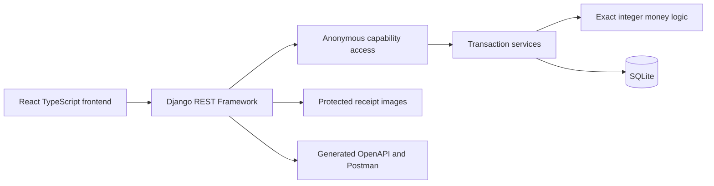

# Splitly

A Django expense-sharing application for groups of friends. Create a group, add people, record expenses, and see who owes whom. The responsive frontend uses white/lime surfaces and original monochrome illustrated people. No sign-in is required.

Equal splitting across every current member is the default. Custom amounts support unequal shares. Bill photos are optional: an expense can be saved without one. This app records debts and payments made elsewhere; it does not transfer money or verify people's identities.

## Run locally

Requirements: Python 3.13 and Node.js 22.17 or newer compatible Node 22 release. SQLite is included with Python. Use the repository root for backend commands.

PowerShell:

```powershell
python -m venv .venv
.\.venv\Scripts\python.exe -m pip install -r requirements-dev.txt
npm ci --prefix frontend
npm run build --prefix frontend
.\.venv\Scripts\python.exe manage.py migrate
.\.venv\Scripts\python.exe manage.py runserver 127.0.0.1:8000
```

macOS/Linux:

```bash
python3 -m venv .venv
source .venv/bin/activate
pip install -r requirements-dev.txt
npm ci --prefix frontend
npm run build --prefix frontend
python manage.py migrate
python manage.py runserver 127.0.0.1:8000
```

Open [Splitly](http://127.0.0.1:8000). First visit starts an empty private workspace; nothing is silently seeded. The frontend is built once and served by Django on the same origin. For UI development, run Django on port 8000 and `npm run dev --prefix frontend` in another terminal; Vite proxies API requests.

Development generates an ignored `.local-secret` so session/invitation signatures survive restart. Production requires a generated `DJANGO_SECRET_KEY`, explicit hosts, HTTPS, persistent storage and secure cookies. Shell environment variables configure local Django; `.env` is consumed by Compose, not automatically loaded by Django.

## Docker

The image builds the frontend and runs migrations, static collection and Waitress. SQLite and receipt images share a persistent volume. Run one application instance with this SQLite setup.

PowerShell:

```powershell
$env:DJANGO_SECRET_KEY = python -c "import secrets; print(secrets.token_urlsafe(48))"
docker compose up --build
```

macOS/Linux:

```bash
export DJANGO_SECRET_KEY="$(python3 -c 'import secrets; print(secrets.token_urlsafe(48))')"
docker compose up --build
```

Open port 8000. Compose deliberately disables secure cookies/HTTPS redirect for this local HTTP demonstration. For an HTTPS deployment, restore secure settings and configure trusted origins/hosts. Do not use the Django development server in production. Preserve the volume and secret between restarts; changing the secret invalidates signed invitations/sessions.

## Hosted demonstration

The full application can run as one free Render Docker web service. The selected free demo has temporary storage: expenses and photos reset when Render idles, restarts or redeploys it. A cold first visit can take about one minute. Deployment settings and live verification commands are documented in [hosting notes](docs/public/deployment.md); `render.yaml` contains the reproducible deployment recipe.

## Architecture



Django owns validation, persistence, access and calculations. DRF route serializers describe contracts; service functions own transactions. Pure money functions calculate integer paise without database dependencies. React renders persisted server results and provides accessible forms and recovery states. No independently editable balance cache exists.

The source is documented at module, public-function and important invariant boundaries. Read the [API quickstart](docs/public/api.md), [architecture and schema](docs/public/architecture.md), and [enhancement decisions](docs/public/enhancement.md). Private planning documents are excluded from Git and Docker context.

## Database design

Workspace holds the owner's private capability. Person is a display identity with a stable avatar key; it is separate from a Django login account. Group belongs to a workspace and has a signed invitation nonce. Membership links people and groups with uniqueness enforced.

Expense stores payer, amount, description, split method and optional receipt metadata. ExpenseShare stores every member's share at creation, including payer and zero shares. Later membership additions cannot rewrite old expenses. Settlement records a direct debt payment. IdempotencyRecord stores successful keyed requests and responses for retry safety. Django sessions preserve owner access when joining shared groups.

Foreign keys, uniqueness/check constraints and transactional validation protect records. SQLite IMMEDIATE write transactions serialize expense/member/settlement operations. More details are in the public schema document.

## Money and split rules

- INR only; storage and calculations use integer paise.
- API accepts ordinary decimal strings or JSON numbers with at most two fractional digits. Decimal decoding prevents an intermediate binary float. Invalid precision is rejected, never silently rounded.
- Equal split uses integer division and distributes leftover paise in ascending member-ID order. Shares differ by at most one paise and sum exactly to the expense amount.
- Custom split supplies every current member exactly once, permits zero, and must sum exactly to the expense amount. Equal remains default when custom shares are absent.
- Each non-payer owes their saved share to payer. Opposite debts cancel per pair. Payer never owes self.
- Gross owes, gross receivable, spending, allocated shares and net position are distinct. Zero group net does not imply direct debts are settled.
- Payments cannot exceed the current direct debt; they update only their group.

Original assignment case: Mohit pays ₹1,200 for Mohit, Rahul and Ankit. Each share is ₹400; Rahul and Ankit each owe Mohit ₹400. Custom example: ₹1,000 split ₹500/₹300/₹200 with Mohit paying yields Rahul→Mohit ₹300 and Ankit→Mohit ₹200.

## Product enhancement

Balance explanations are the primary enhancement. **Why this amount?** shows the exact expense and settlement contributions behind a pairwise debt, including opposite contributions and rounding where relevant. Explanations remain available when debt becomes zero.

This solves disagreements about opaque totals and makes ledger correctness inspectable. Using immutable shares avoids a second accounting system. Tradeoffs include extra query/UI work, paginated history and disclosure of descriptions to authorized collaborators. The complete explanation total always covers all history, not just visible rows.

Custom splitting, settlement recording and optional bill photos are additional features. Photo attachment is separate from expense creation so a failed upload does not lose a saved expense. Photos are validated and served through authorized endpoints, not an open media directory. No OCR is performed.

## API and Postman

Open **API docs** inside the application for a guided quickstart, interactive explorer and downloadable OpenAPI/Postman artifacts. Schema endpoint is `/api/openapi.json`; collection `/api/postman.json`; environment `/api/environment.json`. Exports contain no live access key. The Postman collection is an endpoint catalog: configure access and record IDs using the quickstart before running individual requests.

Base path `/api/v1` covers users, groups, members, expenses, balances, explanations, settlements and protected receipt uploads. Financial creates require `Idempotency-Key`; user/group creates accept it optionally. Frontend always supplies create keys. Same key/normalized payload replays original success, changed payload conflicts, new key means new intent. Decimal strings and equivalent numeric amounts normalize identically.

Browser uses a Django session and CSRF protection. Postman can use explicit capability headers. Owner `X-Workspace-Key` grants a logical workspace; `X-Group-Key` grants only one shared group. Group links use URL fragments and no sign-in. The API lists every accessible user across bounded pages, rather than exposing other workspaces' people. IDs identify records; names are display fields and may repeat.

## Assumptions and limits

Anyone holding a group invitation can view/contribute to that group and choose any member as payer. Identity is self-declared. An invitation does not grant other groups or unrelated people. Avoid real sensitive financial data for a hiring demonstration.

Expenses and membership are addition-only; financial editing/deletion and member removal are not implemented. No foreign-currency conversion, notifications, banking, realtime synchronization or receipt scanning. Refresh/focus updates other collaborators' changes. SQLite is appropriate for this single-instance assignment, not a horizontal-scaling promise.

Each private workspace is an isolated logical system: its owner can list all its users across pages, while a shared-group capability sees only that group's accessible people. Workspace isolation, pagination, versioned paths, ID-based balances and exact money representations are deliberate adaptations to the suggested API examples. Core functional behavior remains the same. The README and API walkthrough make access/bootstrap explicit for reviewers.

## Tests

Backend:

```powershell
.\.venv\Scripts\python.exe manage.py check
.\.venv\Scripts\python.exe manage.py makemigrations --check --dry-run
.\.venv\Scripts\python.exe -m pytest --cov=ledger --cov=config --cov-branch --cov-report=term-missing --cov-fail-under=80
.\.venv\Scripts\python.exe -m ruff check config ledger scripts
.\.venv\Scripts\python.exe scripts/verify_artifacts.py
```

Frontend/browser:

```bash
npm run test:coverage --prefix frontend
npm run build --prefix frontend
cd frontend
npx playwright install chromium
npm run test:e2e
```

On macOS/Linux replace the explicit Windows Python path with activated `python`. Playwright starts its isolated Django and Vite services automatically; see its configuration. CI runs backend/unit coverage, build, browser journeys, API-artifact verification and a Docker runtime smoke test. Coverage thresholds are at least 80%. Measured results and the scope of verification are in [verification notes](docs/public/validation.md).

## Improvements with more time

Add verified identity and roles, invitation rotation/expiry, financial correction events, group-only people portability, PostgreSQL deployment/concurrency checks, audited data deletion, richer custom split modes and CSV export. Investigate transfer suggestions separately from direct obligations; a simple greedy algorithm must not be advertised as mathematically optimal.

## Assets

Portraits are original SVG artwork created for this app; they are stable decoration, not identities. Manrope font files are bundled from Fontsource with their included license. Functional controls use a consistent SVG vocabulary. The design reference informed style only; no screenshot branding or portraits were extracted for production.
