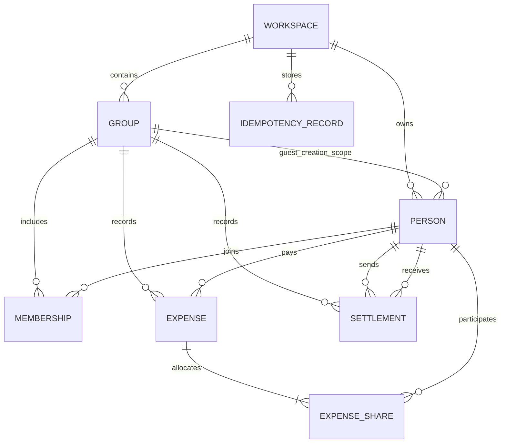

# Architecture and database

React and TypeScript render the web interface. Django and Django REST Framework own access checks, validation, transactions, allocations, balances, and API documentation. Vite proxies `/api` to Django during development; the production build is served from the same origin by Django. SQLite keeps local setup small. Transactions use SQLite's IMMEDIATE mode so ledger writes are serialized; the service returns a retryable error for a transient lock instead of creating a partial expense.

Business logic sits in the ledger service layer. API views handle request/response concerns and scope; serializers validate the boundary; models provide durable relations and constraints. The frontend displays saved server shares and server balances rather than independently calculating an alternative ledger.

| Record | Purpose and constraints |
| --- | --- |
| Workspace | Random private owner capability; contains groups and people. |
| Group | Workspace foreign key, name, sharing nonce, creation timestamp. |
| Person | Workspace foreign key, self-declared name, stable portrait key, optional group creation scope. Duplicate names are allowed; IDs distinguish people. |
| Membership | Group/person relation with a unique constraint preventing duplicate membership. |
| Expense | Group, payer, positive bounded integer paise, description, split type, optional receipt attachment, timestamp. Group/recent-ID index supports history. |
| ExpenseShare | Expense/person relation and integer paise; unique per expense/person. Saves the exact membership snapshot, including payer. |
| Settlement | Group, debtor, creditor, positive bounded integer paise, timestamp. Self-payments are forbidden. |
| IdempotencyRecord | Access scope, operation, retry key, normalized request hash, successful response/status. The combination is unique within a workspace. |

Financial records are immutable through the API; editing, deletion, and member removal are intentionally outside the implemented scope. Foreign-key protection avoids accidentally deleting people/groups referenced by ledger records. Expense-share cleanup on deleting its owning expense is an ORM relation rule, not an exposed deletion feature.

## Invariants

1. Membership and payer must belong to the same authorized workspace/group. Group guests can add existing group members or people created in that group context.
2. Every accepted expense creates all shares atomically. Allocations sum to the expense amount, including awkward amounts such as INR 100.01 for three members.
   Equal is the default; optional custom shares must include every current member once and sum exactly to the expense total. Zero custom shares are allowed.
3. Historical shares never change when a new member joins. Read operations use saved shares.
4. A pair's debt is the sum of its expense contributions minus recorded direct payments. Opposite contributions cancel; no self-debt appears. All member net positions sum to zero.
5. A settlement cannot exceed the current direct group debt. Checking debt and saving payment happen in the same serialized transaction.
6. A successful uncertain write can be replayed with its original key without creating a second financial record.

## Decisions and limits

Capability access keeps the requested no-sign-in flow simple and makes group sharing explicit. It does not verify who created an entry or prove that a reported payment happened. The UI always asks for the payer; it never treats the browser operator as an authenticated member.

SQLite is appropriate for the assignment and a small trusted deployment. A larger multi-worker system should move to PostgreSQL with deliberate row-locking and concurrency tests. Current balances are derived from immutable records rather than maintained as editable cache fields. This favors correctness and explainability; a production system with large histories would add measured aggregation/caching while retaining the underlying ledger.

Production configuration requires an explicit secret and secure cookies. Development can use a generated local secret kept outside Git. Capability links are bearer secrets: anyone holding one can use its granted scope. The public API docs and exports contain placeholders, not real keys. Full account authentication, link expiry/revocation controls, audit attribution, rate limits, and payment-provider integration remain future work.

Receipt upload is a separate operation after the ledger commit. This keeps a transient media failure from rolling back a valid expense or duplicating it on retry. Media reads enforce the same expense scope; raw media is not publicly served. Uploaded content must decode to an allowed image format and fit the size bound. Optional photographs document the bill but do not extract or validate line items.
